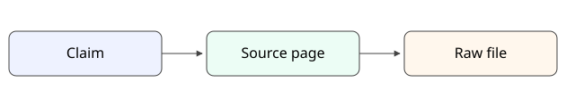

# Citation chain

A compiled claim does not stand alone. It points to the source page
that compiled it, and that page points to the preserved raw file —
so a reader can walk the chain in either direction and check each
link.

*Figure 1: claim → source page → raw file — every compiled claim keeps the chain that supports it.*

The diagram is a hand-authored SVG kept as a plain text file under
`raw/diagrams/`, embedded here with alt text and a caption line so
the Lens renders it as a figure and the media fidelity check can
verify that the reference resolves.
